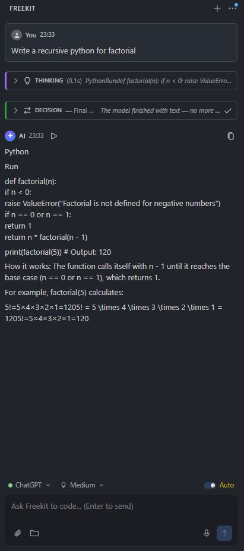
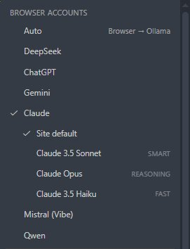
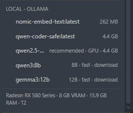
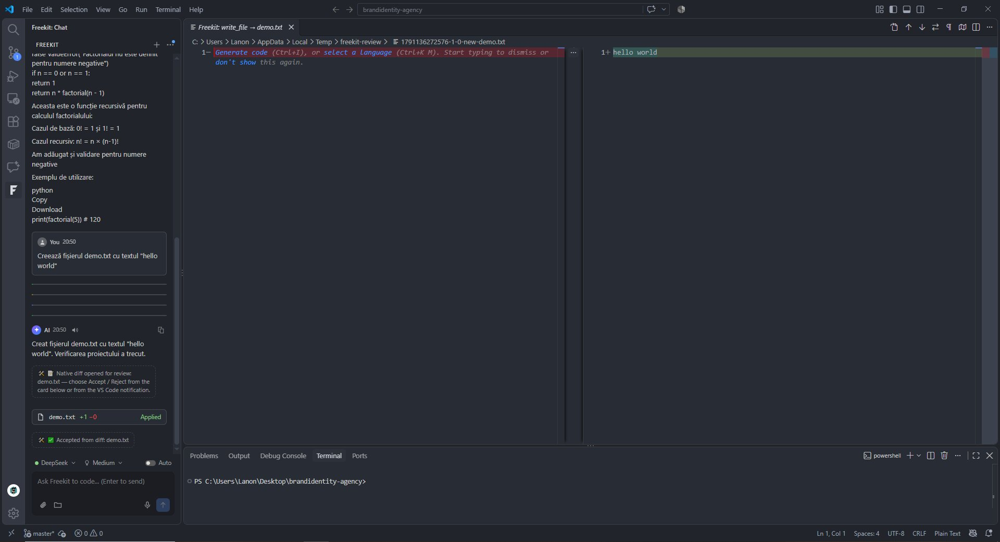
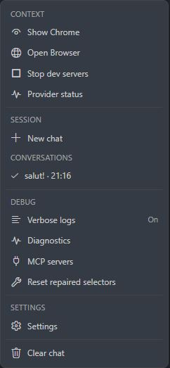
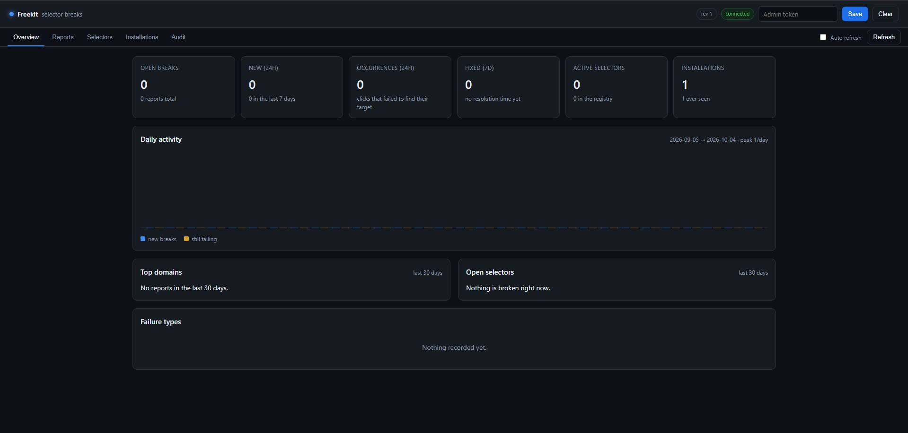

# Freekit

> **Free AI coding agent for VS Code.** Use your existing web AI accounts (DeepSeek, ChatGPT, Claude, Gemini, Mistral, Qwen) or a local Ollama model. **No API keys, no subscriptions, no cost.** Works on Windows / macOS / Linux with Chrome or Edge installed.

[](https://marketplace.visualstudio.com/items?itemName=builderweb.freekit)
[](https://marketplace.visualstudio.com/items?itemName=builderweb.freekit)
[](https://marketplace.visualstudio.com/items?itemName=builderweb.freekit)
[](https://code.visualstudio.com)



---

## Why Freekit?

Unlike every other AI coding agent, **Freekit works with the web AI accounts you already have**. No API keys. No credit card. No monthly subscription.

| Feature | Freekit | Cline | Cursor | Copilot |
|---|---|---|---|---|
| Web AI providers (no API keys) | **6** | No | No | No |
| Cost | **$0** | API costs | $20/mo | $10-19/mo |
| Works with free accounts | **Yes** | No | No | No |
| Local Ollama (hardware-aware) | Yes | Yes | Limited | No |
| Self-maintaining selectors | Yes | No | No | No |
| Native VS Code diff review | Yes | Yes | Yes | No |

### Perfect for

- Students and hobbyists without API budgets
- Developers in emerging markets (cost-sensitive)
- Anyone who already has a ChatGPT Plus / Claude Pro subscription
- Privacy-conscious users (fully local via Ollama)

### How Freekit compares

**Them:** you pay $10-50/month for API keys (OpenAI, Anthropic, etc.).
**Freekit:** it uses the free web chat you already have open. **$0.**

Cline is better if you want 100% uptime with paid API keys.
Freekit is better if you want **zero cost**, or you're in a market where API costs matter.

---

## Quick start

1. Install Freekit from the VS Code Marketplace
2. Open the sidebar → click the **F** icon
3. Click the **model chip** at the bottom → select a provider (e.g. DeepSeek)
4. A Chrome window opens → **log in once** (your session is saved)
5. Start chatting — try: `Write a Python function for factorial`

**First time?** VS Code may show a blue **Restricted Mode** banner. Click **Trust** to enable full functionality (Freekit writes files and runs commands — this is required).

---

## Screenshots








---

## Features

- **Six web AI providers + Ollama** — DeepSeek, ChatGPT, Claude, Gemini, Mistral, Qwen, plus local Ollama
- **Stealth mode** — human-like typing (real keydown/keyup) with anti-detection
- **Agentic loop** — up to 40 iterations, 12 tools (read / write / edit / search / run / git)
- **Native diff review** — each file change opens in VS Code's diff viewer; accept or reject it from the card in the chat
- **Git checkpoints** — restore any prompt with one click
- **Fork & edit conversations** — ChatGPT-style conversation branching
- **TTS + voice input** — offline Whisper transcription
- **Semantic code search** — find code by meaning, not just text
- **MCP servers** — Model Context Protocol support
- **Hardware-aware Ollama** — 51-model catalog, tiers T0–T6, auto-recommendation
- **Auto-verify, root-cause diagnosis & auto-repair** — every file write is checked (`tsc --noEmit` / `astro check` / `build`); failures are parsed and traced to their root cause, the AI gets a compact diagnostic plus the exact fix and must answer with **one `edit_file`**. Band-aid patches (`?.` on `.map()`, `|| []`, `if (!x) return`) are rejected. Up to 3 repair cycles, then an automatic rollback. Every repair session is saved to `docs/diagnostics/<timestamp>.md`
- **Dev servers in a visible terminal** — `npm run dev`, `vite`, `nodemon` start in a dedicated VS Code terminal, and the AI gets the live URL immediately
- **Visual verification** — `screenshot` captures any page (full page by default) or one element (by CSS `selector` or plain-language `description`). `compare_visual` screenshots the original and the replica, opens them side by side, sends both to a vision provider, and writes the differences to `docs/screenshots/compare-<timestamp>.md`
- **Verbose mode** — collapsible Thinking / Executing / Result / Decision cards for full transparency
- **VS Code-native chat UI** — every status, button and step uses monochrome `@vscode/codicons`
- **Attachments & auto-context** — files, folders, images and binaries, plus project structure sent with every message

---

## Supported providers

### Web (browser automation — no API key needed)

- **DeepSeek** (Chat V3 / DeepThink R1)
- **ChatGPT** (GPT-4o / GPT-4.1 / o3)
- **Claude** (Sonnet / Opus / Haiku)
- **Gemini** (2.5 Pro / 2.5 Flash)
- **Mistral** (Vibe)
- **Qwen** (Qwen3-Max / Qwen3-VL — the best for `compare_visual`)

### Local

- **Ollama** — 51-model catalog, hardware tiers T0–T6, auto-recommendation based on VRAM and RAM. Warns when a model is too small for real code (under 3B) and points to the free web providers on machines without a GPU.

---

## Provider reliability for agentic tasks

Some providers occasionally refuse to emit an action, or lose the format on long, multi-step tasks. In practice:

| Provider | Behaviour |
|---|---|
| Gemini | Accepts from first message |
| DeepSeek | Accepts from first message |
| Ollama (local) | Always compliant |
| Claude | Rarely refuses |
| Mistral | Rarely refuses |
| Qwen | Rarely refuses |
| ChatGPT free | May refuse complex multi-step tasks |

For complex tasks, prefer **Gemini**, **DeepSeek** or **Ollama**. If a provider refuses mid-task, switch the **model chip** in the composer to another provider and press **Retry** — Freekit hands the new provider the **full task context** (original task, every tool call already made, the files already read, current state and next step), so the task continues seamlessly.

---

## How it works

Freekit connects to your **existing web AI sessions** via browser automation:

1. Launches an **isolated Chrome profile** (separate from your personal Chrome)
2. You log in **once** to each provider (session is saved)
3. Freekit types messages with **human-like keystrokes** (real keydown/keyup, random delays)
4. It reads the AI response and renders it in the VS Code sidebar
5. Every message is **classified before it is sent** → a **question** gets a direct answer (short prompt: no tools, no plan), a **task** gets the agentic tool pipeline (log: `[chat] prompt classified as: question|task`)
6. File changes appear as **native VS Code diffs** — accept or reject each one from the card in the chat

Everything is local. No middle server. No data sent to third parties.

---

## Privacy

- **Zero telemetry** — no analytics, no tracking
- **Isolated browser** — separate Chrome profile, doesn't touch your personal browser
- **Local by default** — Chrome profile, history and settings stay on your disk
- **Browser automation** — messages go through the web AI (same as if you typed them manually)
- **Self-reporting** (opt-in, on by default) — anonymous selector break reports to help fix issues. No code, files or messages sent. Disable: `freekit.reporting.enabled`
- **Ollama option** — fully offline, nothing leaves your machine

---

## Trust / Restricted Mode

Freekit writes files, runs terminal commands and controls a browser — it needs a **trusted workspace**.

On first launch, VS Code shows a blue **Restricted Mode** banner. Click **Trust** to enable full functionality.

**In Restricted Mode (no trust):**

- Chat UI works
- Read-only tools (`read_file`, `search_files`, etc.)
- File writes, terminal commands, git mutations, MCP tools are blocked

You can also run `Freekit: Trust This Workspace` from the Command Palette.

Additional safeguards:

- Writes open a **native VS Code diff** for review — accept or reject from the in-chat card
- Shell commands and git operations require approval cards unless **auto-approve** is enabled
- Anti-spam limits: max 3 writes per file and 15 write operations per message
- The webview runs with a strict Content Security Policy

---

## Known limitations

- **A folder is optional for questions, required for tasks.** You can open VS Code with no folder and just ask something — the chat works and the answer comes back normally, with a discreet reminder at the end (`Open a folder if you want to save code to files`). Tasks (creating/editing files, running commands) need an open project: Freekit shows a card with **Open a folder** — pick a recent project (Home / Desktop / Documents are scanned for `.git`, `package.json`, `pyproject.toml`, `composer.json`, `Cargo.toml`, `go.mod`) or browse for one. The folder opens in the same window and the original task **resumes automatically**.
- **The welcome card is shown once.** On the very first open (no conversations yet) the chat shows a quick-start card; **Got it** or sending your first message dismisses it for good. It only comes back if you delete every conversation.
- **Web providers change their UI.** Selectors can break when a provider ships a redesign. Freekit repairs them automatically (bundled → learned → AI Finder) and falls back to a card with **Repair now** / **Switch provider** / **Diagnostics** only when everything else failed.
- **A provider chat can hit its context limit** ("Chat memory full"). Freekit asks whether to start a new chat and continue the task there instead of failing silently.
- **ChatGPT runs every task in a fresh chat.** The web chat keeps its own history, and a polluted one made ChatGPT echo the system prompt instead of calling tools (even after *New chat*). For ChatGPT, Freekit now opens a new chat before each task, verifies it is empty (start page + empty composer) and sends the system prompt first, then your message as a second one — so consecutive tasks do not share the browser chat.
- **Login sessions expire.** If a provider is logged out, Freekit brings the Chrome window to the front and offers **Log in again** / **Retry** / **Switch provider** / **Diagnostics** right in the chat.

---

## Commands

| Command | What it does |
|---|---|
| `Freekit: Trust This Workspace` | Grant Workspace Trust to the current folder — unlocks file writes, shell commands, git changes and MCP tools |
| `Freekit: Close Browser` | Really close it (graceful CDP close + PID fallback) |
| `Freekit: Show Browser` | Launch the dedicated Chrome if it is not running, then bring its window on screen and focus it |
| `Freekit: Show Provider Status` | Detailed report: CDP port, DeepSeek login, Ollama models |
| `Freekit: Clear No-Ask File List` | Forget the files you marked "Accept (don't ask again)" |
| `Freekit: Reset Repaired Selectors` | Forget auto-repaired selectors, go back to `selectors.json` |
| `Freekit: Update Selectors` | Fetch and apply the selector config from the configured Gist |
| `Freekit: Diagnostics` | Environment check: browser, CDP port, profile, Ollama, selectors, MCP |
| `Freekit: MCP Servers` | Manage MCP servers: status, restart/stop, list tools, open/create `.vscode/mcp.json` |
| `Freekit: Setup Local Whisper` | Download the prebuilt whisper.cpp binaries + `ggml-base` model into global storage (one time, ~160 MB) for offline voice input |
| `Freekit: Install Ollama` | Open the official Ollama download page |
| `Freekit: Stop Dev Servers` | Stop every dev server started by the AI |
| `Freekit: Index Workspace` | Build / update the local semantic index (embeddings via Ollama, incremental, cancellable) |
| `Freekit: Index Status` | Show the index: model, dimensions, indexed files, chunks, storage file, size and last update |
| `Freekit: Clear Index` | Delete the workspace's semantic index from globalStorage |
| `Freekit: Reporting Status` | Show the reporting integration state |
| `Freekit: Run Selector Health Check` | Immediately check the selectors of the providers that have a tab open |
| `Freekit: Reset Reporting Registration` | Remove the local reporting identity |
| `Freekit: Unlock broken selectors` | Test every manually written (user-locked) selector from all providers whose chat is open in Chrome; the broken ones are removed from `_meta.locked` and repaired by the AI Finder (a timestamped backup is saved first) |
| `Freekit: Unlock broken selectors (provider...)` | Same as above, but you pick a single provider. Each provider also has its own `Freekit: Unlock broken — ChatGPT` / `Claude` / `DeepSeek` / `Mistral` / `Gemini` / `Qwen` command |
| `Freekit: Reset selector failure counters` | Reset `_meta.failures` for all six providers (give user-locked selectors a fresh 3-failure budget) |
| `Freekit: Reset selector failure counters (provider...)` | Reset `_meta.failures` for a single provider |

---

## Settings

| Setting | Default | Description |
|---|---|---|
| `freekit.provider` | `deepseek` | Active provider (`auto` = browser provider → Ollama fallback) |
| `freekit.ollamaModel` | `qwen2.5-coder:7b` | Model used in local mode |
| `freekit.ollamaUrl` | `http://localhost:11434` | Ollama server URL |
| `freekit.cdpPort` | `9222` | CDP port used to launch / connect Chrome |
| `freekit.chromePath` | *(empty)* | Manual Chrome/Edge path (empty = auto-detect) |
| `freekit.messageTimeoutMinutes` | `20` | Total time budget for one agentic message |
| `freekit.providerTimeout` | `90` | Seconds to wait for one response from the web chat (10–1800 s). The page is probed at 15 s / 30 s / 60 s / 90 s. At 90 s with no sign of activity, Freekit retries **once** with a shorter prompt and only then stops. Each check logs `[stuck-check] <Provider> @15s: ...` |
| `freekit.autoVerify` | `true` | Check the project after every file write (`astro check` / `tsc --noEmit` / `build`); failures are parsed and root-caused, the AI gets a compact diagnostic + the exact fix and must answer with one `edit_file`. Up to 3 repair cycles, then an automatic rollback |
| `freekit.screenshotOpenMode` | `preview` | How a `screenshot` / `compare_visual` capture is opened (`preview` / `beside` / `none`) |
| `freekit.promptCheckpoints` | `true` | Create a git checkpoint before every prompt and show the restore button on each user message |
| `freekit.autoInitGit` | `true` | Run `git init` (plus a minimal `.gitignore`) when the project folder isn't a git repo yet |
| `freekit.selectorsUrl` | *(empty)* | Raw URL of a public Gist with `selectors.json`; empty = remote selectors disabled |
| `freekit.checkSelectorsOnStartup` | `true` | Look for a newer selector config at startup — at most once every 24 h |
| `freekit.handoffThreshold` | `20` | Tool results pasted in the same browser chat before Freekit opens a new chat with a full handoff |
| `freekit.humanTyping` | `true` | Type messages with human timing (random delays, punctuation pauses, bursts) |
| `freekit.humanBehavior` | `true` | Small mouse moves before clicks + occasional gentle scroll (anti-detect) |
| `freekit.mutationObserver` | `false` | Experimental: end-of-generation detection via MutationObserver |
| `freekit.autoAcceptPopups` | `true` | Automatically accept consent popups (cookie / terms / OK / Got it) |
| `freekit.sttLanguage` | `ro-RO` | Language for voice input (local Whisper) — `ro-RO` or `en-US` |
| `freekit.whisperCliPath` | *(empty)* | Path to `whisper-cli` for offline voice input |
| `freekit.whisperModelPath` | *(empty)* | Path to the Whisper ggml model (e.g. `ggml-base.bin`) |
| `freekit.whisperTimeoutSeconds` | `180` | Timeout for one Whisper transcription (10–1200 s) |
| `freekit.aiSelectorFinder.mode` | `api-proxy` | How a broken selector is repaired automatically: `off` / `ollama` / `browser` / `api-proxy`. In `api-proxy` mode a **truncated** proxy reply (the upstream stream can be cut mid-JSON) is retried up to 3 times, and only then does the browser fallback run |
| `freekit.aiSelectorFinder` | `false` | **Deprecated** — use `freekit.aiSelectorFinder.mode`. Still honoured as an opt-out: when `mode` is **not** set explicitly and this is `false`, the AI selector finder is disabled (same as `mode: "off"`). Any other value defers to `mode` |
| `freekit.aiFinderModel` | `auto` | Ollama model for the AI selector finder in `ollama` mode |
| `freekit.aiFinderTimeoutSeconds` | `30` | Timeout per AI selector-analysis attempt in `ollama` mode |
| `freekit.aiFinderProxyUrl` | `https://freekitproxy.identitate-brand.workers.dev` | Endpoint used by `api-proxy` mode |
| `freekit.mcpEnabled` | `true` | Start the configured MCP servers and expose their tools to the AI |
| `freekit.mcpServers` | `{}` | MCP servers to launch (stdio) |
| `freekit.mcpToolTimeoutSeconds` | `60` | Timeout for a single MCP tool call |
| `freekit.semanticIndex.enabled` | `true` | Enable semantic code search |
| `freekit.semanticIndex.model` | `nomic-embed-text` | Ollama embedding model for the index |
| `freekit.semanticIndex.onSave` | `false` | Re-index a file automatically (incremental, debounced) when it is saved |
| `freekit.semanticIndex.maxFileKb` | `256` | Skip files larger than this (KB) when indexing |
| `freekit.semanticIndex.topK` | `8` | Number of chunks returned by `search_semantic` (1–25) |
| `freekit.semanticIndex.exclude` | `[]` | Extra directory/file names to exclude from indexing |
| `freekit.reporting.enabled` | `true` | Master switch for the reporting-server integration |
| `freekit.reporting.endpoint` | `https://api.builderweb.app` | Base URL of the reporting server |
| `freekit.reporting.shareDomSnapshot` | `false` | Also send a cleaned DOM snapshot when reporting a broken selector |
| `freekit.reporting.healthCheck` | `true` | Periodically verify the selectors of providers that already have a tab open |
| `freekit.reporting.healthCheckIntervalHours` | `6` | Hours between two automatic selector health checks |
| `freekit.reporting.selectorsIntervalHours` | `24` | Hours between two automatic fetches of repaired selectors |

---

## Advanced

### Semantic code search

Freekit can find code **by meaning** instead of exact text — useful for questions like *"where do we retry a failed upload?"* when you don't know the identifier to grep for.

1. Run **`Freekit: Index Workspace`** once (needs Ollama running; the embedding model is pulled with `ollama pull nomic-embed-text`).
2. Ask the AI something conceptual. It calls `search_semantic(query)` and gets back the best-matching chunks.

How it works:

- **Local & private** — embeddings are computed by your own Ollama server; the vector store is a single JSON file under `<globalStorage>/semantic-index/`. No cloud, no new npm dependencies.
- **Incremental** — each file is fingerprinted with a SHA-1 of its content; unchanged files keep their existing vectors.
- **Smart exclusions** — `node_modules`, `.git`, `out`, `dist`, `build`, `.next`, `coverage`, virtualenvs, `target`, caches, lockfiles, source maps, minified and binary files are never indexed.
- **Chunking with overlap** — files are split into 60-line windows with a 12-line overlap.
- **Graceful in the agent loop** — if there is no index yet, `search_semantic` tells the AI to fall back to `search_files`.

### Remote selector updates

Selector repairs can reach every client without shipping a new extension version:

1. Keep the same JSON shape as `src/selectors.json` and **bump `version`**.
2. Save it as a file named `selectors.json` in a **public GitHub Gist**.
3. Set `freekit.selectorsUrl` to the Gist **raw** URL.

Freekit then checks on startup — rate-limited to once every 24 h — and on demand via `Freekit: Update Selectors`.

### Reporting server (self-maintaining)

Freekit can feed a central reporting server (`https://api.builderweb.app` by default) so a site redesign discovered on one machine turns into a fix for everybody.

- **Register once** — on first start, the extension creates a random installation id and exchanges it for an `apiKey`.
- **Health check every 6 h** — for every provider that already has a tab open, the `input` and `newChat` selectors are verified. Broken slots are repaired locally first; only if that also fails is a report sent.
- **Selector updates every 24 h** — the extension asks for new selectors and applies them.
- **Privacy** — nothing from your code, prompts or files is ever sent. The optional DOM snapshot is off by default.

### MCP servers

Freekit ships a **Model Context Protocol** client: MCP servers give the agent extra tools (databases, browsers, APIs, file systems, …) beyond the built-in ones.

1. Add servers to `.vscode/mcp.json` (or to the `freekit.mcpServers` setting):

```json
{
  "servers": {
    "filesystem": {
      "command": "npx",
      "args": ["-y", "@modelcontextprotocol/server-filesystem", "."]
    }
  }
}